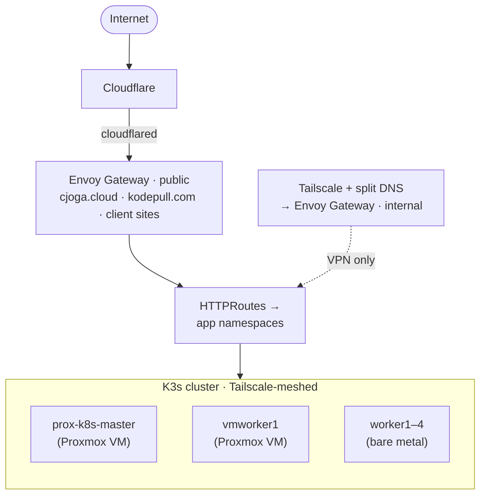

import TechStackGrid from '@site/src/components/TechStackGrid';

# Homelab overview

The site you're reading runs on a [K3s](https://k3s.io/) cluster I run myself — six nodes split between a [Proxmox](https://www.proxmox.com/) host and a handful of bare-metal machines, meshed over [Tailscale](https://tailscale.com/), with [Envoy Gateway](https://gateway.envoyproxy.io/) in front and a [Cloudflare Tunnel](https://www.cloudflare.com/products/tunnel/) handling the public edge. It hosts `cjoga.cloud`, `blog.cjoga.cloud`, `kodepull.com`, and roughly a dozen other projects I run for myself or for [KodePull](/engineering/work/kodepull).

## How it's wired today

Six nodes: one K3s control-plane node living as a Proxmox VM (`prox-k8s-master`), one second VM worker on the same Proxmox host, and four bare-metal workers, all joined to the cluster over Tailscale. Storage is the `local-path` provisioner that ships with K3s, so each volume lives on the disk of the node that runs it. Secrets are [OpenBao](https://openbao.org/) — the FOSS Vault fork — fronted by [External Secrets Operator](https://external-secrets.io/), which reads it over the in-cluster Service, so apps consume Kubernetes secrets without ever touching the bao directly. TLS is [cert-manager](https://cert-manager.io/) plus Let's Encrypt.

Ingress is Envoy Gateway via the [Gateway API](https://gateway-api.sigs.k8s.io/), in two data planes. The public one has a `Gateway` per production domain, merged into one shared Envoy deployment, with `HTTPRoute`s per app. Its edge is a Cloudflare Tunnel: `cloudflared` runs as pods in the cluster, and Cloudflare proxies public hostnames in. The internal one has its own `Gateway` per domain and answers only on the VPN: Tailscale's split DNS sends those domains to a CoreDNS inside the cluster, which resolves them to the internal data plane. The admin tools — n8n, Semaphore, OpenBao — are attached to the internal one only.

The platform layer — Envoy Gateway, that CoreDNS, cert-manager's issuer, the Cloudflare tunnel, the Tailscale subnet router — is managed from KodePull's cluster repository. My lab repo keeps the personal workloads and the `cjoga.cloud` gateways.

<TechStackGrid
  caption="The stack"
  items={[
    'K3s',
    'Proxmox',
    'Tailscale',
    'Envoy',
    'Cloudflare',
    { name: 'Longhorn', retired: '2026-05' },
    'OpenBao',
    'External Secrets',
    'cert-manager',
    "Let's Encrypt",
  ]}
/>

## How it got here

The architecture took three iterations to settle.

### v1 — three nodes on WiFi, and a flannel cascade

The first version was three physical machines on WiFi, all on the same network. K3s plus Traefik — the default k3s setup. The first headache came from being mixed-distro: two nodes on Ubuntu and one on Rocky Linux. Networking, storage drivers, and the OS commands the cluster relied on did not behave the same on both sides, and the differences kept biting.

The bigger problem was the WiFi itself. When a node briefly dropped its connection, or when it hit disk or memory pressure, [flannel](https://github.com/flannel-io/flannel) on that node would fall over — and the failure rippled, taking pod-to-pod networking down across the rest of the cluster. Manual recovery became the daily mode.

That's what produced the self-healing Ansible playbook I still run today. It checks `tailscaled`, the flannel interface, the K3s service, CoreDNS resolution, and disk usage on every node; heals what it can (restarts services, recreates interfaces, prunes container images when disk is elevated, vacuums journals when it's critical); and reports a per-node status block at the end. It's the closest thing the lab has to a node operator, and it's been running long enough to outlast two cluster topologies.

### v2 — wire everything, mesh the rest

The next iteration moved the cluster off WiFi entirely. Once the core nodes were wired, the rule became: any node that lived outside the LAN had to come in over a private network, not the public internet. The choice was Tailscale. A Tailscale gateway runs as a pod in the cluster, advertising the cluster's subnets to the rest of my tailnet. On the DNS side, Magic DNS is configured to split traffic for internal hostnames to a dedicated CoreDNS deployment running inside the cluster — so any device on the VPN resolves internal services through cluster DNS without me having to wire up an external resolver.

### v3 — Proxmox, Envoy, and a public tunnel

The current shape settled in once I moved the K3s master onto a Proxmox VM. Putting the control plane on a VM made it easier to back up, easier to move, and easier to share a box with other infrastructure I didn't want on dedicated hardware. A second VM worker on the same Proxmox host joined the cluster, alongside the bare-metal workers that came over from v1 and v2.

Two more changes locked the architecture down. **Public ingress moved from Traefik to Envoy Gateway.** k3s ships with Traefik wired in, but I wanted to follow the upstream Gateway API direction rather than vendor-specific CRDs. Migration was per-domain: stand up an Envoy `Gateway` for `cjoga.cloud`, port the routes, cut over, repeat for `kodepull.com` and the client sites. The Traefik bits are still in the cluster but they no longer serve real traffic. **External access is a Cloudflare Tunnel.** No exposed ports on my home network — `cloudflared` pods open outbound connections to Cloudflare, and Cloudflare proxies public hostnames into Envoy. The tunnel itself is still managed in the Cloudflare UI rather than as code; that's a deliberate trade-off I'll probably revisit, but it's worked well enough that I haven't.

### After v3 — local storage, internal ingress, a handover

v3 is still the shape. Three changes in 2026 reworked it from inside.

**Longhorn went away.** Through v3, storage was [Longhorn](https://longhorn.io/), and it cost more memory than the lab had to spare: by late May the control-plane VM and one bare-metal worker were both above 90% memory. On May 27, 2026 I wrote a runbook to move all nineteen Longhorn volumes onto `local-path` and uninstall Longhorn, which I expected to free about 25 GB of RAM across the cluster. By August 29 the `longhorn-system` namespace no longer existed, and wherever the lab repo's manifests name a storage class, it's `local-path`. The [replica notes](/engineering/lab/tips-and-gotchas/longhorn-replicas) are from the Longhorn era.

**Ingress split in two.** Until late August, public traffic and my own devices on the VPN landed on the same Envoy data plane, so a hostname could only serve one version, and every deploy, even of work in progress, touched what the public saw. On August 29 I added a second, internal-only data plane with a `Gateway` per domain, and pointed the cluster's CoreDNS at it. The same URL now shows the public version outside the VPN and the internal one inside it, and an app can opt in to ship a branch to the VPN before it goes public. The same day I took n8n, Semaphore and OpenBao off the public gateways.

**The platform moved to KodePull.** On September 6, 2026 I handed the platform layer — Envoy Gateway, the internal CoreDNS, cert-manager's issuer, the Cloudflare tunnel, the Tailscale subnet router and the Headlamp dashboard — to KodePull's cluster repository, which is now its only source of truth. I deleted the copies from my lab repo instead of keeping them in sync: two authoritative sources for one cluster object is how a fix gets silently reverted.

## What runs on it now

Production workloads include this portfolio and the handbook (`cjoga.cloud`), the KodePull marketing site and internal tooling (`kodepull.com`, an Outline docs instance, an invoice generator, a leads tool), KodePull client sites, a Discord and WhatsApp bot stack, a private n8n environment, Azure DevOps self-hosted agents, and a handful of personal projects (`pucmm-band`, a Minecraft server). `elcriollo` used to be on that list; its namespace was gone by August 29, 2026, and I removed its manifests from the lab repo that day. The Ansible health playbook runs from [Semaphore](https://semaphoreui.com/) as a scheduled job, so the cluster heals itself overnight without me logging in.

For the failure modes that taught me what the playbook actually has to cover, see [Tips and gotchas](/engineering/lab/tips-and-gotchas).

import AuthorCard from '@site/src/components/AuthorCard';

<AuthorCard />
